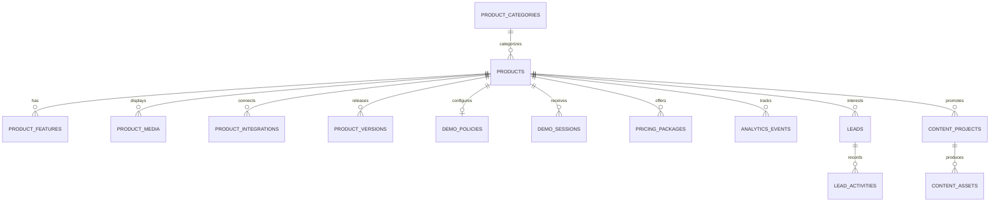

# Database Design — Initial Logical Model

## Principles
- PostgreSQL with UUID primary keys where appropriate.
- `created_at` and `updated_at` timestamps on mutable business entities.
- Foreign keys and indexes for lookup paths.
- RLS enabled on exposed tables.
- No service-role key in browser code.
- Keep demo data separate from production product databases.
- Avoid storing secrets in ordinary configuration tables.

## Core entities
| Entity | Purpose |
|---|---|
| profiles | Authenticated staff profile and role reference |
| products | Product catalog and publication status |
| product_categories | Catalog taxonomy |
| product_features | Product feature list |
| product_media | Approved images/videos and metadata |
| product_integrations | URL/API/iframe integration metadata (no raw secrets) |
| product_versions | Product release history |
| demo_policies | Per-product demo policy |
| demo_sessions | Short-lived demo session metadata |
| demo_activity_logs | Security and session events |
| pricing_packages | Product-specific commercial packages |
| leads | Prospects and consent metadata |
| lead_activities | CRM timeline |
| sales_inquiries | Quotes and consultation requests |
| licenses | Issued license metadata |
| testimonials | Approved customer testimonials |
| articles | Insights CMS |
| analytics_events | Consent-aware first-party events |
| content_projects | Content generation projects |
| content_assets | Generated and uploaded assets |
| content_templates | Reusable design/video templates |
| content_calendar | Planned content publication |
| ai_recommendations | Recommendations with evidence metadata |
| audit_logs | Administrative/security audit trail |

## Relationship overview

## Access model
- Public: read published product/category/features/media/pricing and published articles only.
- Authenticated staff: access according to role and assigned permissions.
- Demo visitor: no general database access; only a short-lived session scoped to the demo controller and isolated demo app.
- Super Admin: privileged operations, with audit logging and MFA recommended.

## Retention
Set explicit retention periods for raw analytics, expired demo sessions, audit logs, generated assets, and leads. Retention must reflect business needs and applicable privacy requirements. Do not retain unnecessary personal data indefinitely.
