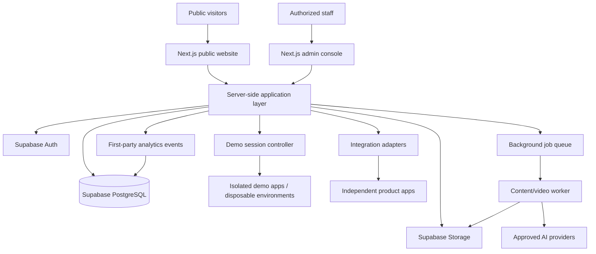

# System Architecture

## 1. High-level architecture

## 2. Logical layers
- Experience layer: public website, admin console, demo entry and preview.
- Application layer: product catalog, pricing, CRM, content, analytics, demo policies.
- Security layer: auth, RBAC, RLS, server-side policy checks, rate limits, audit logs.
- Data layer: PostgreSQL, object storage, event data, job metadata.
- Integration layer: direct links, safe iframe, API adapters, later SSO.
- Async layer: image processing, AI jobs, video rendering, scheduled cleanup.

## 3. Deployment boundaries
The hub and each product may be deployed independently. The hub stores metadata and integration configuration, not copies of each product's production database. Demo environments must be separate from production. Prefer disposable demo tenants or isolated demo deployments with synthetic data.

## 4. Trust boundaries
- Browser is untrusted; all authorization and expiry checks are server-side.
- Admin APIs require authenticated role and resource-level authorization.
- Demo tokens are short-lived and scoped to one product/session.
- AI provider keys remain server-side.
- Webhook endpoints verify signatures and idempotency.
- Integration health checks must defend against SSRF and private-network access.

## 5. Integration modes
### Direct URL
Store canonical URL, health-check policy, product status, and allowed redirect domains.

### iframe
Use only where the target app allows embedding. Configure CSP `frame-ancestors` deliberately. Never remove browser security headers to force embedding.

### API
Use server-to-server adapters, scoped credentials, timeouts, retries, schema validation, and audit logs.

### SSO
Later phase: select a standard protocol (OIDC preferred where supported), define issuer/client registration, audience, scopes, logout behavior, and per-product authorization.

## 6. Suggested runtime components
- Next.js App Router for public and admin experience.
- Supabase Auth and PostgreSQL.
- Supabase Storage for approved media assets.
- Redis-compatible store for rate limits, ephemeral session coordination, and queue support if required.
- Background worker for AI/content/video jobs.
- Monitoring/error reporting provider selected before production.

## 7. Reliability
Define timeouts, retry limits, idempotency, graceful degradation, health endpoints, database backup, and recovery objectives before production launch.
